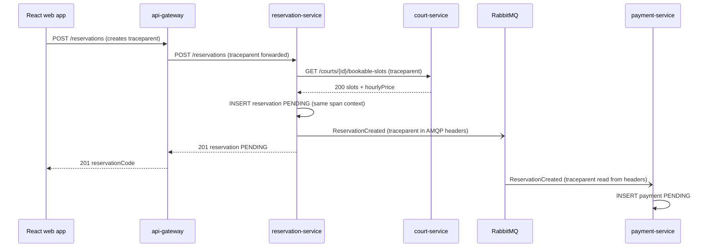

# CP1 - Critical journey and trace map

## Journey: Create a court reservation

A customer picks a court, a date and a whole-hour range in the React web app and creates a
reservation. The reservation is stored as `PENDING` and the payment-service records a
`PENDING` payment for it. This is the core flow of Futbolix (FR-006 to FR-011) and it
crosses five components: web app, api-gateway, reservation-service, court-service and
payment-service, plus RabbitMQ.

Source in ftx-docs: `05-architecture/overview.md`, `02-domain/domain-events.md`,
`07-api/contracts/openapi/reservation-service.yaml`, `court-service.yaml`.

## Hops

| Step | Caller | Receiver | Protocol | Operation | Sync/Async | Data touched |
|------|--------|----------|----------|-----------|------------|--------------|
| 1 | React web app | api-gateway :8080 | REST | `POST /reservations` | sync | none |
| 2 | api-gateway | reservation-service :8083 | REST | `POST /reservations` | sync | none yet |
| 3 | reservation-service | court-service :8082 | REST | `GET /courts/{id}/bookable-slots?date=` | sync | schema `court` (read) |
| 4 | reservation-service | PostgreSQL | JDBC | insert reservation `PENDING` | sync | schema `reservation` |
| 5 | reservation-service | RabbitMQ | AMQP | publish `ReservationCreated` to `futbolix.events` / `reservation.created` | async | queue |
| 6 | payment-service :8084 | RabbitMQ | AMQP | consume `ReservationCreated` | async | none |
| 7 | payment-service | PostgreSQL | JDBC | insert payment `PENDING` + `processed_events` | sync | schema `payment` |

## Sequence diagram

## Trace context propagation

- HTTP hops (1, 2, 3): W3C header `traceparent: 00-<trace_id>-<span_id>-01`. The api-gateway
  creates it if the web app did not send one, and every service forwards it on outgoing calls.
- RabbitMQ hop (5, 6): reservation-service copies `traceparent` into the AMQP message headers
  of `ReservationCreated`. payment-service reads it from the headers when it consumes the
  message, so the async part keeps the same `trace_id`.
- The `eventId` of the event is NOT the trace id. It is the idempotency key. Both travel.

## Span tree

- `POST /reservations` - api-gateway (root span, kind SERVER)
  - `POST /reservations` - reservation-service (kind SERVER)
    - `GET /courts/{id}/bookable-slots` - reservation-service (kind CLIENT)
      - `GET /courts/{id}/bookable-slots` - court-service (kind SERVER)
        - `SELECT court_schedule` - court-service (kind INTERNAL, schema `court`)
    - `INSERT reservation` - reservation-service (kind INTERNAL, schema `reservation`)
    - `publish reservation.created` - reservation-service (kind PRODUCER)
      - `consume reservation.created` - payment-service (kind CONSUMER, crosses the async
        boundary, same `trace_id`)
        - `INSERT payment` - payment-service (kind INTERNAL, schema `payment`)

## Notes

- Today tracing is not adopted in Futbolix: it is registered as technical debt AT-002 in
  `05-architecture/overview.md`. This map is the first step to close it.
- Without the trace id in the AMQP headers, a reservation that stays `PENDING` because the
  payment was never created cannot be linked to the original request (see AT-004).
