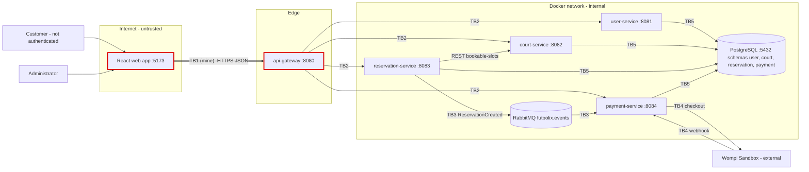

# CP1 - Attack surface and trust boundaries

System: Futbolix (court reservation). Source: ftx-docs `05-architecture/overview.md`,
`07-api/contracts/openapi/*.yaml`, `02-domain/domain-events.md`.
My boundary: **TB1 - React web app (internet) -> api-gateway** (issue #48).

## Data flow diagram

| Boundary | From -> To | Owner |
|----------|-----------|-------|
| **TB1** | React web app (internet) -> api-gateway | **@HERMAR55611 (#48)** |
| TB2 | api-gateway -> user / court / reservation / payment services | free |
| TB3 | reservation-service -> RabbitMQ -> payment-service | free |
| TB4 | payment-service <-> Wompi Sandbox | @emelendez20201-ship-it (#47) |
| TB5 | services -> PostgreSQL | free |

## Asset inventory

| Asset | Where it lives | Classification |
|-------|----------------|----------------|
| Customer contact data (customerName, customerEmail, customerPhone) | `POST /reservations` body, schema `reservation` | confidential |
| Reservation code (e.g. `FTX7Q2K9M4`) | `GET /reservations/{reservationCode}`, schema `reservation` | confidential |
| Administrator credentials and JWT (RS256) | `POST /auth/login`, user-service, schema `user` | restricted |
| Court schedules and hourly price | court-service, schema `court`, `GET /courts/{id}/bookable-slots` | public |
| Reservation status and amount (PENDING / CONFIRMED, COP) | schema `reservation`, `ReservationCreated` event | internal |
| Payment status and Wompi transaction id | payment-service, schema `payment` | confidential |

## Entry points of TB1

| Entry point | Method | Who calls it | Authentication today |
|-------------|--------|--------------|----------------------|
| `/availability` | GET | customer (web app) | none (public) |
| `/courts`, `/courts/{id}/bookable-slots` | GET | customer | none (public) |
| `/reservations` | POST | customer | none, `Idempotency-Key` header, rate limit at gateway |
| `/reservations/{reservationCode}` | GET | customer | none, knowledge of the code |
| `/reservations/{reservationCode}/cancellation` | POST | customer | none, knowledge of the code |
| `/auth/login`, `/auth/refresh` | POST | administrator | username + password, then JWT |
| `/admin/reservations`, `/admin/courts/{id}` | GET / PATCH | administrator | JWT validated at the gateway |
| port 8080 | TCP | anyone on the internet | TLS termination at the gateway |
