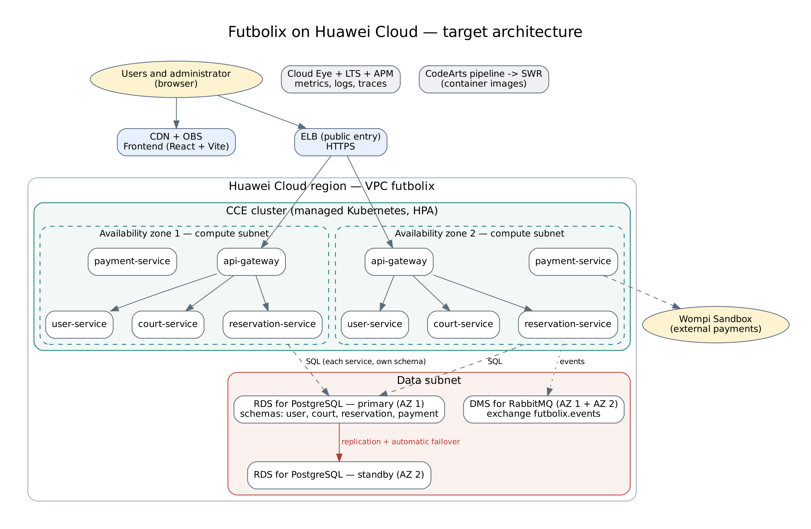

# Architecture design note — Futbolix

## 1. Target architecture

I would run the five Futbolix services (api-gateway, user-service, court-service,
reservation-service and payment-service) on CCE, Huawei Cloud's managed Kubernetes. The
services are already packaged as Docker containers, so CCE lets me manage them in one place,
scale each service on its own demand with HPA, and restart failed containers automatically,
without managing virtual machines one by one as I would with ECS. The worker nodes of the
cluster are spread over two availability zones, so losing one zone does not stop the system.

For the data I would use RDS for PostgreSQL in primary/standby mode across two availability
zones. Today one PostgreSQL instance holds the four schemas, a single point of failure
(AT-001): if it fails, every service fails with it. RDS gives automatic backups, point-in-time
recovery (PITR) and higher availability, which supports the RTO and RPO of section 4.

For messaging I would use DMS for RabbitMQ. Running RabbitMQ in a container means owning its
maintenance, availability, monitoring and recovery; a managed broker removes that operational
load and keeps the events between services flowing. The React + Vite frontend is a static
site, so it goes to OBS behind CDN, and the only public entry to the backend is an ELB in
front of api-gateway.

| Component in the diagram | Defined in (file of your team's -docs) |
|---|---|
| Frontend (React + Vite) on OBS + CDN | 05-architecture/deployment.md |
| ELB in front of api-gateway | 05-architecture/decisions/records/ADR-004-api-gateway.md |
| api-gateway | 05-architecture/decisions/records/ADR-004-api-gateway.md |
| user-service | 05-architecture/overview.md (section 4, service catalog) |
| court-service | 05-architecture/overview.md (section 4, service catalog) |
| reservation-service | 05-architecture/overview.md (section 4, service catalog) |
| payment-service | 05-architecture/decisions/records/ADR-009-service-decomposition.md |
| RDS for PostgreSQL (schemas user, court, reservation, payment) | 05-architecture/decisions/records/ADR-003-database-per-service.md and 06-data/models.md |
| DMS for RabbitMQ (exchange futbolix.events) | 05-architecture/decisions/records/ADR-006-outbox-pattern.md |
| VPC, two availability zones, subnets | 05-architecture/deployment.md |

## 2. Five principles

I took each weakness from what our team already wrote in ftx-docs, mainly the technical debt
table of the architecture overview and the security analysis. The table keeps one row per
principle, and each decision points to the Huawei Cloud service that implements it.

| Principle | Current weakness | Evidence in -docs | Design decision | Huawei Cloud service |
|---|---|---|---|---|
| Reliability | One PostgreSQL instance holds the four schemas; if it goes down, users cannot see courts, reserve or pay (AT-001) | 05-architecture/overview.md | Move the data to a managed primary/standby database in two availability zones, with automatic backups and point-in-time recovery | RDS for PostgreSQL (primary/standby) |
| Security | Services talk to each other without encryption (AT-003) and every service uses the same broker user `futbolix` | 05-architecture/security/stride-soymiguelgomez.md | Use mTLS between services so each one verifies the identity of the other, keep credentials out of the code in a secrets store, and give each service only the permissions it needs | CCE with ASM (mTLS), DEW for secrets, IAM |
| Performance efficiency | reservation-service checks availability against PostgreSQL on every request, so it and the database slow down when many people reserve at the same time | 06-data/models.md | Scale reservation-service horizontally with HPA, keep concurrency control in the database so two reservations of the same slot cannot both succeed, and tune the availability queries | CCE (HPA), RDS for PostgreSQL |
| Cost | Every environment (develop, qa, prod) runs the full platform all the time, even when nobody uses it | 10-devops/environments.md | Keep only the replicas the demand needs with autoscaling, switch off the develop and qa resources outside working hours, watch storage use and review the bill every month | CCE autoscaling, Cost Center |
| Operations | There is no distributed tracing; following a reservation across gateway, reservation-service, RabbitMQ and payment-service means correlating logs by hand (AT-002) | 13-operations/observability.md | Centralize metrics, logs and traces, and set alerts on errors and response times so the team acts before users notice | Cloud Eye, LTS, APM |

## 3. Scalability

api-gateway receives and routes every request of the users, and reservation-service handles the
availability checks and the creation of reservations, so they are the two services with the
most traffic. I use HPA on CCE for them. The other three services keep a fixed minimum of two
replicas, one per availability zone, and can grow to four.

| Service | Scaling metric | Threshold (number and unit) | Min instances | Max instances |
|---|---|---|---|---|
| api-gateway | Average CPU use of the pods | 70 % | 2 | 6 |
| reservation-service | Average CPU use of the pods | 70 % | 2 | 8 |
| user-service | Average CPU use of the pods | 70 % | 2 | 4 |
| court-service | Average CPU use of the pods | 70 % | 2 | 4 |
| payment-service | Average CPU use of the pods | 70 % | 2 | 4 |

The minimum of two keeps one replica in each availability zone. The services can scale like
this because they keep no state in memory: the data lives in PostgreSQL and the events in
RabbitMQ, so any replica can answer any request. These numbers are a first
proposal; I would adjust them after load tests on the qa environment.

## 4. Disaster recovery

- Critical data store: the `reservation` schema in PostgreSQL (reservation-service)
- RTO: 30 minutes
- RPO: 5 minutes
- DR pattern (chapter 11): active-passive (warm standby): an RDS for PostgreSQL primary in one availability zone and a standby in the other, plus automatic backups with point-in-time recovery
- Why the pattern meets those numbers: the standby receives every change from the primary
  through replication and RDS promotes it automatically when the primary fails, which takes a
  few minutes, well inside the RTO of 30 minutes and with almost no data lost. If the data
  itself is damaged (for example, a bad migration), point-in-time recovery uses the transaction
  logs that RDS backs up every few minutes, so the loss stays inside the RPO of 5 minutes, which
  a daily backup alone could never meet.

## 5. Automated deployment

GitHub Actions is blocked today by the billing of the organization, so the tests run by hand
with Docker. Since Futbolix moves to Huawei Cloud, I would use CodeArts, which joins build,
tests and deployment in one place and works directly with SWR and CCE. The pipeline keeps the
branch flow of the team (develop, qa, main) and reuses the files that already exist in our
repositories.

| Stage | Trigger | Tool or service | File in your team's repositories |
|---|---|---|---|
| Build | Pull request to develop, qa or main | CodeArts Build (Maven, Java 21) | ftx-reservations-api/pom.xml |
| Test | The same pull request, after the build | CodeArts Build running `mvn verify` with Testcontainers | ftx-reservations-api/.github/workflows/ci.yml |
| Image | Merge to qa or main | CodeArts Build pushes the image to SWR, tagged with the version | ftx-reservations-api/Dockerfile |
| Deploy to qa | Merge to the qa branch | CodeArts Deploy to the qa namespace of CCE, migrations first | ftx-workflow/compose.yml |
| Deploy to production | Tag vX.Y.Z on main, after the approval of the teacher (CODEOWNERS) | CodeArts Deploy to the prod namespace of CCE, rolling update | ftx-workflow/scripts/start-platform.ps1 |
| Rollback | Health checks or alerts fail after a deployment | CCE rollback to the previous image tag stored in SWR; rollback scripts for the schema | ftx-reservations-db/05_rollbacks/ |

If a new version fails, I keep the previous image in SWR, return the deployment to that tag
with Kubernetes, and then check that every service answers its health check again.

## 6. Decisions

- [ADR-C3-01](ADR-C3-01.md): run the five Futbolix services on CCE (managed Kubernetes) with autoscaling
- [ADR-C3-02](ADR-C3-02.md): move PostgreSQL to RDS for PostgreSQL in primary/standby mode across two availability zones
